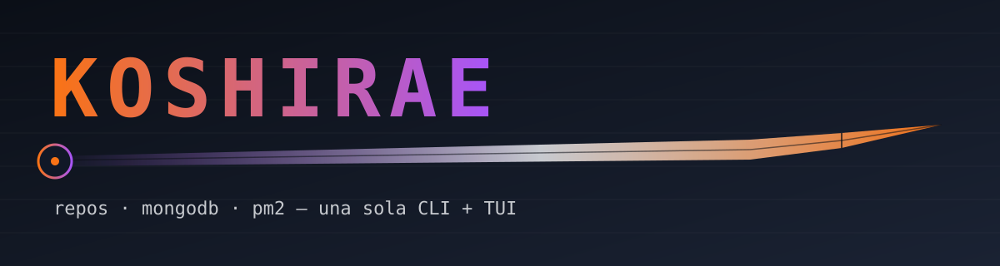

<p align="center">
  
</p>

# Koshirae

[](https://github.com/Zer0Dev-exe/koshirae/actions/workflows/ci.yml)
[](pyproject.toml)
[](LICENSE)

Repos (GitHub/GitLab/Bitbucket), MongoDB/Atlas y procesos con PM2 desde una sola CLI + TUI.

Koshirae unifica tres herramientas en un único comando:

| Subcomando | Antes | Qué hace |
|---|---|---|
| `koshirae repo` | GitKeeper | Lista, busca, describe (con IA), archiva y borra repos de GitHub, GitLab y Bitbucket. |
| `koshirae mongo` | Mangosta | Administra MongoDB self-hosted y Atlas: bases, colecciones, documentos, índices, usuarios, clusters. |
| `koshirae watch` | GitMaster | Vigila repos locales: `git pull`, build y reinicio de procesos PM2. |

Cada subcomando tiene además su interfaz interactiva (`tui`).

## Índice

- [Instalación](#instalación)
- [Inicio rápido](#inicio-rápido)
- [Uso](#uso)
  - [repo](#koshirae-repo)
  - [mongo](#koshirae-mongo)
  - [watch](#koshirae-watch)
- [Configuración](#configuración)
- [Desarrollo](#desarrollo)
- [Contribuir](#contribuir)
- [Seguridad](#seguridad)
- [Licencia](#licencia)

## Instalación

Requiere **Python 3.11 o superior**.

```bash
git clone https://github.com/Zer0Dev-exe/koshirae.git
cd koshirae
pip install .            # o: pipx install .
```

Extras opcionales para generar descripciones con IA (`koshirae repo describe`):

```bash
pip install ".[claude]"   # Anthropic
pip install ".[gemini]"   # Google Gemini
pip install ".[openai]"   # OpenAI
pip install ".[ai]"       # todos
```

También funcionan los agentes de terminal `claude-code`, `codex` y `gemini-cli` si los tienes instalados.

Requisitos externos según lo que uses:

- `koshirae mongo shell` necesita [`mongosh`](https://www.mongodb.com/docs/mongodb-shell/) en el `PATH`.
- `koshirae watch` necesita `git` y, para reiniciar procesos, [PM2](https://pm2.keymetrics.io/).

### Comandos instalados

| Comando | Equivale a |
|---|---|
| `koshirae`, `ksr` | CLI completa |
| `gk` | `koshirae repo` |
| `mgs` | `koshirae mongo` |

## Inicio rápido

```bash
koshirae --help
koshirae repo auth login github      # guarda tu token
koshirae repo recent                 # tus repos con más actividad
koshirae repo tui                    # interfaz interactiva

koshirae mongo auth login            # inicia sesión con tu cuenta de MongoDB
koshirae mongo db list

koshirae watch add                   # registra un proyecto a vigilar
koshirae watch start                 # pull + build + PM2 en continuo
```

## Uso

Usa `-h`/`--help` en cualquier nivel (`koshirae repo describe -h`) para ver todas las opciones.

### `koshirae repo`

```bash
koshirae repo list                    # lista tus repositorios
koshirae repo recent                  # actividad más reciente
koshirae repo latest                  # últimos creados
koshirae repo search <texto>          # busca repositorios
koshirae repo show <repo>             # detalle
koshirae repo open <repo>             # abre en el navegador
koshirae repo describe --missing      # descripción con IA para los que no tienen
koshirae repo set-description <repo> "texto"
koshirae repo topics <repo> a b c     # reemplaza topics (GitHub y GitLab)
koshirae repo archive <repo>          # solo lectura
koshirae repo delete <repo>           # irreversible
koshirae repo auth status             # cuentas e IA configuradas
```

`describe` admite `--dry-run` (solo muestra la propuesta), `--yes`, `--lang es|en|…` y `--no-topics`.

Para GitHub Enterprise o GitLab self-hosted: `koshirae repo auth login gitlab --url https://gitlab.ejemplo.com`.
Bitbucket requiere `--username` (email de Atlassian) y opcionalmente `--workspace`.

### `koshirae mongo`

Opciones globales: `--profile/-p`, `--uri`, `--json` (salida para scripts) y `--yes/-y`.

| Grupo | Comandos |
|---|---|
| General | `auth`, `profile`, `shell`, `ui` |
| Datos | `db`, `coll`, `doc`, `index` |
| Seguridad | `user`, `role`, `access` |
| Monitorización | `server` |
| Atlas | `org`, `project`, `cluster`, `members` |

```bash
koshirae mongo --uri "mongodb://localhost:27017" db list
koshirae mongo -p produccion --json coll list mi_base
koshirae mongo cluster list
```

### `koshirae watch`

```bash
koshirae watch add               # registra o actualiza un proyecto
koshirae watch list              # proyectos y ajustes
koshirae watch start             # vigila en continuo
koshirae watch check-now         # comprueba una vez y sale
koshirae watch pm2-status        # procesos PM2 detectados
koshirae watch push-all          # commit + push de lo pendiente
koshirae watch logs              # logs en vivo con filtros
koshirae watch tui               # panel interactivo
```

## Configuración

Cada subcomando guarda su configuración en el directorio de usuario del sistema (vía `platformdirs`):

| Variable | Efecto |
|---|---|
| `GITKEEPER_CONFIG` | Ruta del `config.toml` de `repo` (por defecto `<config>/gitkeeper/config.toml`). |
| `MANGOSTA_HOME` | Directorio de configuración de `mongo`. |
| `MANGOSTA_PROFILE` | Perfil de `mongo` a usar. |
| `MANGOSTA_URI` | URI de conexión puntual para `mongo`. |
| `KOSHIRAE_WATCH_DIR` | Directorio de configuración de `watch`. |

> Los tokens se almacenan en local, en tu directorio de configuración. No los subas a ningún repositorio.

## Desarrollo

```bash
git clone https://github.com/Zer0Dev-exe/koshirae.git
cd koshirae
python -m venv .venv && source .venv/bin/activate
pip install -e ".[dev,ai]"
pytest
```

Estructura:

```
src/koshirae/
├── cli.py        # punto de entrada: repo | mongo | watch
├── repo/         # GitKeeper: proveedores (github, gitlab, bitbucket), IA, TUI
├── mongo/        # Mangosta: comandos, Atlas, TUI
└── watch/        # GitMaster: git, build, PM2, logs
tests/            # pytest, un directorio por subcomando
```

Para generar un ejecutable: `pip install ".[build]"` y usar PyInstaller.

## Contribuir

Lee [CONTRIBUTING.md](CONTRIBUTING.md). La rama `main` está protegida: los cambios entran por pull request. Este proyecto sigue el [Código de Conducta](CODE_OF_CONDUCT.md).

## Seguridad

Para reportar una vulnerabilidad, mira [SECURITY.md](SECURITY.md). No abras un issue público.

## Licencia

[MIT](LICENSE) © 2026 Zer0Dev-exe
